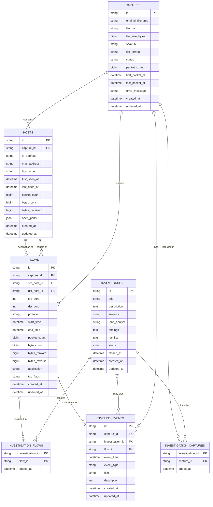

# PCAP-MAN Database Design

PCAP-MAN is **entity-centric**: the database stores *things an investigator cares about*
(captures, hosts, flows, investigations), not a giant list of packets.
Packets stay inside the original capture file as evidence.

Captures are retained as evidence files; the engine's derived hosts, flows, and timeline records
are persisted against each capture. A fresh database starts empty.

## Rules for every table

- `id`: a UUID (text, 36 characters). Stable, never reused.
- `created_at`, `updated_at`: always **UTC**, timezone-aware. Saving a datetime without a timezone is rejected.
- Links between tables use **foreign keys** (enforced; SQLite needs `PRAGMA foreign_keys=ON`, done in `app/database/session.py`).
- Constraint and index names follow a fixed naming convention (`app/database/base.py`) so migrations stay predictable.

## The chain

```text
Capture  ->  Host  ->  Flow  ->  Investigation
```

1. A **Capture** (an imported PCAP file) contains many **Hosts**.
2. A **Flow** is one conversation between two Hosts of the same Capture.
3. An **Investigation** collects the Flows and Captures an analyst is looking into.
4. A **TimelineEvent** records something that happened at a point in time in a Capture, optionally tied to a Flow or an Investigation.

## ERD



## Relationships and delete behaviour

| Link | If the parent is deleted |
| --- | --- |
| Capture -> Hosts, Flows, TimelineEvents | They are deleted too (they only make sense inside their capture) |
| Host -> Flows (source / destination) | The flows are deleted too |
| Investigation / Capture / Flow -> link tables | The link rows are deleted; the other side survives |
| Investigation -> TimelineEvents | `investigation_id` becomes empty; the events stay |
| Flow -> TimelineEvents | `flow_id` becomes empty; the events stay |

An Investigation is never deleted just because a Capture was removed.

## Design decisions

- **Hosts belong to one capture.** The same IP in two captures is two Host rows. (A given IP can appear only once per capture.) Matching hosts across captures can be added later without changing this structure.
- **Investigations link to captures and flows through two small link tables**, because one investigation can include many of each, and one capture or flow can belong to many investigations.
- **Status and format values** (`pcap`/`pcapng`; `imported`/`processing`/`completed`/`failed`; `open`/`in_progress`/`closed`) are stored as plain text so they stay easy to read and extend.
- Packet, byte, direction, and timestamp fields are populated by the capture parser. Failed analysis status and error text remain on the capture record.

## Indexes

| Table | Index | Why |
| --- | --- | --- |
| captures | unique `sha256` | Atomically prevent duplicate imports across backend workers |
| hosts | `capture_id`, `ip_address`; unique (`capture_id`, `ip_address`) | List hosts of a capture, look up an IP |
| flows | (`capture_id`, `start_time`), `src_host_id`, `dst_host_id`, `protocol` | Browse a capture's flows in time order, find a host's flows, filter by protocol |
| investigations | `status` | Filter open/closed cases |
| timeline_events | (`capture_id`, `event_time`), (`investigation_id`, `event_time`), `flow_id` | Build timelines quickly |
| link tables | `capture_id` / `flow_id` (the primary key already covers `investigation_id`) | Reverse lookups |

## Future entities

| Entity | Purpose |
| --- | --- |
| Alert | Something suspicious flagged on a host or flow |
| Artifact | A file or object found inside traffic |
| Certificate | TLS certificates seen in traffic |
| Domain | A domain name seen in DNS or TLS traffic |
| URL | A web address seen in traffic |
| Report | A generated investigation report |

They will be added as new tables through new Alembic migrations.

## Migrations (Alembic)

The backend applies migrations automatically at startup. To run them by hand, from `apps/backend`:

```sh
alembic upgrade head      # create / update the database to the latest structure
alembic current           # show which version the database is at
alembic downgrade base    # undo everything (empty database)
```

After changing a model, create a new migration with
`alembic revision --autogenerate -m "short description"`, read the generated file, then commit it.
The default database file is `apps/backend/data/pcapman.db` (never committed).

Capture upload claims are guarded by a unique SHA-256 index, and retrying a failed
capture uses a conditional database update from `failed` to `processing`. These
guards work across backend processes. SQLite serializes writes database-wide;
the upload claim uses `BEGIN IMMEDIATE` and waits up to 30 seconds for SQLite's
write lock. This prevents competing claims but limits concurrent write throughput.
Processing captures also carry a database-backed ownership token and renewable
lease. Workers renew the lease every 30 seconds, with a 120-second initial
duration. A later upload can reclaim a processing capture only when its lease
has expired (or is absent, as with a legacy/incomplete row); all renewal,
failure, and result-persistence updates are fenced by the ownership token. This
allows recovery after worker termination without reclaiming a live worker merely
because analysis is taking a long time. Workers sharing a database must have
reasonably synchronized UTC clocks; clock skew can cause premature or delayed
recovery. SQLite still serializes writes, so lease renewal and uploads contend
for the same database-wide write lock.
The analyzer streams packets synchronously in a worker thread and checks the
ownership-loss signal between packets and during result normalization. This
cooperatively stops stale analysis at the next check; Python cannot forcibly
interrupt Scapy while it is reading or decoding an individual packet. Hard
process termination would require running analysis in a separately managed
process.
The uniqueness migration stops with an explicit error if legacy duplicate fingerprints
already exist; resolve those records before upgrading rather than silently deleting evidence.
A client/server database with row-level locking can provide higher write concurrency when
its driver is installed and configured.
