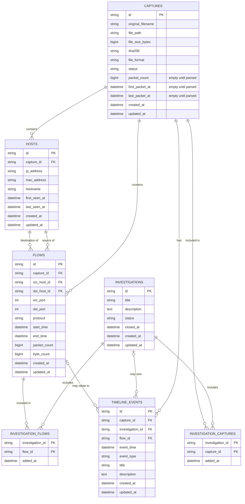

# PCAP-MAN Database Design (Phase 1)

PCAP-MAN is **entity-centric**: the database stores *things an investigator cares about*
(captures, hosts, flows, investigations), not a giant list of packets.
Packets stay inside the original capture file as evidence.

Phase 1 only defines the structure. No packet parsing exists yet, so every table starts empty
and no values are invented.

## Rules for every table

- `id`: a UUID (text, 36 characters). Stable, never reused.
- `created_at`, `updated_at`: always **UTC**, timezone-aware. Saving a datetime without a timezone is rejected.
- Links between tables use **foreign keys** (enforced; SQLite needs `PRAGMA foreign_keys=ON`, done in `app/database/session.py`).
- Constraint and index names follow a fixed naming convention (`app/database/base.py`) so migrations stay predictable.

## The chain

```
Capture  ->  Host  ->  Flow  ->  Investigation
```

1. A **Capture** (an imported PCAP file) contains many **Hosts**.
2. A **Flow** is one conversation between two Hosts of the same Capture.
3. An **Investigation** collects the Flows and Captures an analyst is looking into.
4. A **TimelineEvent** records something that happened at a point in time in a Capture, optionally tied to a Flow or an Investigation.

## ERD



## Relationships and delete behaviour

| Link | If the parent is deleted |
|---|---|
| Capture -> Hosts, Flows, TimelineEvents | They are deleted too (they only make sense inside their capture) |
| Host -> Flows (source / destination) | The flows are deleted too |
| Investigation / Capture / Flow -> link tables | The link rows are deleted; the other side survives |
| Investigation -> TimelineEvents | `investigation_id` becomes empty; the events stay |
| Flow -> TimelineEvents | `flow_id` becomes empty; the events stay |

An Investigation is never deleted just because a Capture was removed.

## Design decisions

- **Hosts belong to one capture.** The same IP in two captures is two Host rows. (A given IP can appear only once per capture.) Matching hosts across captures can be added later without changing this structure.
- **Investigations link to captures and flows through two small link tables**, because one investigation can include many of each, and one capture or flow can belong to many investigations.
- **Status and format values** (`pcap`/`pcapng`; `imported`/`processing`/`completed`/`failed`; `open`/`in_progress`/`closed`) are stored as plain text so they stay easy to read and extend.
- Counters such as `packet_count` and `byte_count` on a Flow default to 0; on a Capture, `packet_count` and the first/last packet times are empty (NULL) until a parser fills them.

## Indexes

| Table | Index | Why |
|---|---|---|
| captures | `sha256` | Find duplicate imports / verify evidence |
| hosts | `capture_id`, `ip_address`; unique (`capture_id`, `ip_address`) | List hosts of a capture, look up an IP |
| flows | (`capture_id`, `start_time`), `src_host_id`, `dst_host_id`, `protocol` | Browse a capture's flows in time order, find a host's flows, filter by protocol |
| investigations | `status` | Filter open/closed cases |
| timeline_events | (`capture_id`, `event_time`), (`investigation_id`, `event_time`), `flow_id` | Build timelines quickly |
| link tables | `capture_id` / `flow_id` (the primary key already covers `investigation_id`) | Reverse lookups |

## Future entities (NOT implemented in Phase 1)

| Entity | Purpose |
|---|---|
| Alert | Something suspicious flagged on a host or flow |
| Artifact | A file or object found inside traffic |
| Certificate | TLS certificates seen in traffic |
| Domain | A domain name seen in DNS or TLS traffic |
| URL | A web address seen in traffic |
| Report | A generated investigation report |

They will be added as new tables through new Alembic migrations.

## Migrations (Alembic)

Run from `apps/backend`:

```
alembic upgrade head      # create / update the database to the latest structure
alembic current           # show which version the database is at
alembic downgrade base    # undo everything (empty database)
```

After changing a model, create a new migration with
`alembic revision --autogenerate -m "short description"`, read the generated file, then commit it.
The default database file is `apps/backend/data/pcapman.db` (never committed).
